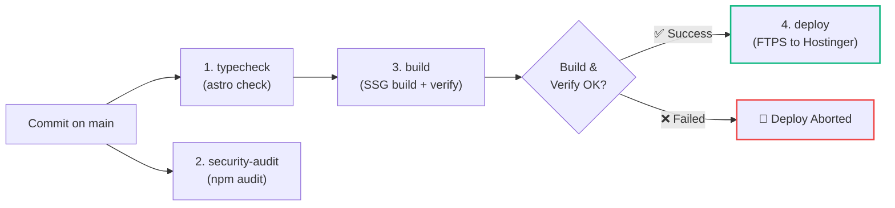

# Pranast Platform: Astro 7 SSG & Infrastructure Hub

This repository serves as the central codebase and technical knowledge hub for the **Pranast Digital Platform**:

1. **Modernized Astro 7 Static Platform:** High-performance, zero-JS by default static site built with **Astro 7.4+** and **Tailwind CSS v4**, replacing the legacy WordPress/Elementor runtime with type-safe Content Collections and sub-second page generation.
2. **Architecture & Infrastructure Knowledge Base:** Centralized technical repository housing system audits, target modernization blueprints, and operational hosting cutover runbooks in [`docs/`](docs/).
3. **Automated FTPS & Edge Deployment:** Automated GitHub Actions workflows for continuous integration (`astro check`, schema validation, static build) and continuous deployment to Hostinger web roots via secure FTPS.

---

## ⚡ Tech Stack Architecture

| Layer | Technology | Specification / Role |
| :--- | :--- | :--- |
| **Framework** | **Astro 7.4.x** | Static Site Generation (`output: 'static'`), zero-JS default, islands architecture |
| **Styling** | **Tailwind CSS 4.3.x** | Native Vite integration via `@tailwindcss/vite`, CSS-first tokens in `src/styles/global.css` |
| **Content Engine** | **Astro Content Layer API** | Typed markdown collections defined in `src/content.config.ts` using `glob` loader and Zod |
| **SEO & Sitemap** | **`@astrojs/sitemap`** | Automated XML sitemap generation with crawl priorities, change frequencies, and index discovery |
| **Language & Tooling**| **TypeScript 5.9.x** / `@astrojs/check` | Strict frontmatter type safety, AST checking, compile-time validation |
| **Deployment Target** | **Hostinger Web Hosting** | Automated FTPS deployment to `public_html` |
| **Edge CDN & DNS** | **Cloudflare** | Edge redirects (Bulk CSV / Workers), SSL/TLS Full (Strict), WAF security |

---

## 🔄 Recent Upgrades: Astro 7 & Tailwind CSS v4

The codebase was recently modernized to **Astro 7** and **Tailwind CSS v4**:

* **Vite-Native Tailwind Integration:** Dropped `@astrojs/tailwind` (which reached end-of-life for Astro 7) and `tailwind.config.mjs`. Integrated `@tailwindcss/vite` directly inside `astro.config.mjs`.
* **CSS-First Theme Tokens:** Brand colors (`brand-50` through `brand-900`) and theme settings are now configured directly in `src/styles/global.css` via `@theme` and `@import "tailwindcss";`. Layouts consume them via `@reference`.
* **Content Layer API Migration:** Migrated content configuration from legacy `src/content/config.ts` to modern root `src/content.config.ts` utilizing `glob` loaders (`astro/loaders`) with deterministic slug-based identifiers (`generateSlugId`).
* **Modern Content Rendering API:** Dynamic page templates (`[...slug].astro`, `blog/[slug].astro`, `case-studies/[slug].astro`) use `render(entry)` from `astro:content` and query entries by `entry.id`.
* **Automated XML Sitemap & SEO Hierarchy:** Configured `@astrojs/sitemap` integration in `astro.config.mjs` with URL serialization (custom `priority` and `changefreq` per section), automatic 404 exclusion filtering, `<link rel="sitemap">` head discovery in `BaseLayout.astro`, and `public/robots.txt` indexing directives.

---

## 📚 Technical Documentation Hub

All system architecture specifications and operational migration guides are structured under [`docs/`](docs/):

- **[Documentation Portal & Index (`docs/README.md`)](docs/README.md)** — Master overview, lifecycle roadmap, and document matrix.
- **Architecture Blueprints (`docs/architecture/`):**
  - [As-Is Tech Stack Analysis (`docs/architecture/uat-pranast-tech-stack.md`)](docs/architecture/uat-pranast-tech-stack.md) — Comprehensive audit of WordPress, PHP 8.5, LiteSpeed, and Elementor.
  - [Target-State Astro Blueprint (`docs/architecture/wordpress-to-astro-migration-plan.md`)](docs/architecture/wordpress-to-astro-migration-plan.md) — Architectural roadmap for static site modernization with Astro & Markdown.
  - [Phase Reports (`docs/architecture/`)](docs/README.md#🗺️-documentation-matrix) — Detailed Phase 1–7 execution reports (content schema, scaffolding, UI components, SEO 301 redirects, decommissioning, edge cutover, and post-cutover verification).
- **Infrastructure Runbooks (`docs/infrastructure/`):**
  - [Cross-Account Hostinger Migration (`docs/infrastructure/hostinger-website-migration.md`)](docs/infrastructure/hostinger-website-migration.md) — Cutover runbook between Hostinger client accounts.
  - [Business to Unlimited Plan Move (`docs/infrastructure/business-to-unlimited-migration-plan.md`)](docs/infrastructure/business-to-unlimited-migration-plan.md) — Step-by-step tier migration strategy.
  - [GitHub Actions CI/CD Specification (`docs/infrastructure/github-actions-ci-cd.md`)](docs/infrastructure/github-actions-ci-cd.md) — Production pipeline for automated validation, static building, and FTPS deployment.

---

## 🚀 CI/CD & Automated Deployment

The repository uses a single, unified, enterprise-grade GitHub Actions pipeline ([`.github/workflows/ci.yml`](.github/workflows/ci.yml)) implementing **strict quality gating** and **Build Once, Deploy Anywhere** principles:



### Pipeline Guarantees & Features:
- **Gated Deployment (`needs: [build]`):** Hostinger deployment is executed **only after** `typecheck` and `build` succeed. Any build failure immediately halts the pipeline, preventing broken code from reaching production.
- **Pull Request Safety:** PRs execute `typecheck`, `security-audit`, and `build` for validation, while the `deploy` job is cleanly skipped.
- **Build Once, Deploy Anywhere:** The `build` job archives the compiled static site (`astro-production-dist`), which the `deploy` job downloads directly—eliminating double compilation and reducing runner runtime by >40%.
- **Adaptive Concurrency:** Stale runs on PRs are auto-cancelled (`cancel-in-progress: true`), but in-flight FTPS uploads to Hostinger on `main` are protected against abrupt termination.
- **Reference & Decision Record:** Full design details are documented in [**ADR-001: Unified Gated CI/CD Pipeline**](docs/infrastructure/adr-unified-ci-cd-pipeline.md) and [**CI/CD Pipeline Specification**](docs/infrastructure/github-actions-ci-cd.md).

---

## 💻 Local Development & Build Commands

For a full step-by-step walkthrough, prerequisites, and troubleshooting, see the [**Local Development Guide (`docs/local-development.md`)](docs/local-development.md)**.

```bash
# Install dependencies
npm ci

# Start local Astro 7 development server (http://localhost:4321)
npm run dev

# Validate TypeScript & Astro Content Layer Schemas (src/content.config.ts)
npm run check

# Build production static site (outputs to dist/ and mirrors to root for web serving)
npm run build

# Preview production build locally
npm run preview

# (Optional) Re-extract WordPress XML into Markdown collections
npm run extract
```

---

## 🌐 Legacy PHP Connectivity Probe

If testing legacy Hostinger PHP connectivity probe behaviors locally:
```bash
php -S localhost:8000
```
Then navigate to [http://localhost:8000](http://localhost:8000).
