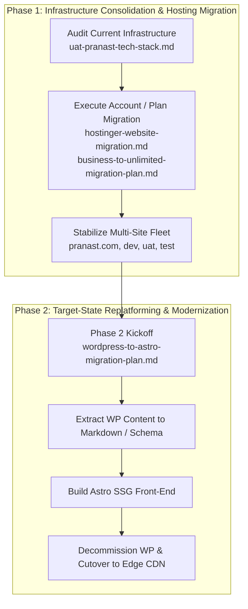

# Pranast Architecture & Infrastructure Documentation

Welcome to the central documentation portal for the **Pranast Digital Platform**. This directory maintains the architectural specifications, system audits, and operational runbooks governing both the current hosting environment and the future-state modernization roadmap.

---

## 🗺️ Documentation Matrix

| Domain | Document | Audience | Status | Description |
|---|---|---|---|---|
| **Architecture** | [As-Is Tech Stack Analysis](architecture/uat-pranast-tech-stack.md) | Architects, Tech Leads | Baseline Reference | Complete audit of WordPress 6.x, PHP 8.5, LiteSpeed, Elementor, and CDN infrastructure on `uat.pranast.com`. |
| **Architecture** | [WordPress to Astro Migration Blueprint](architecture/wordpress-to-astro-migration-plan.md) | Frontend Engineers, Architects | Approved Strategy | Technical blueprint for decommissioning WordPress/Elementor and replatforming to Astro Content Engine (SSG + Markdown). |
| **Architecture** | [Phase 1: Content Inventory & Schema](architecture/phase-1-content-inventory-schema.md) | Frontend Engineers, Content Team | Completed & Validated | Comprehensive inventory of all 17 pages, 6 blog posts, 40 media assets, forms, and Astro Zod collections from WP export. |
| **Architecture** | [Phase 2: Extraction & Scaffolding Report](architecture/phase-2-extraction-scaffolding-report.md) | Frontend Engineers, Architects | Completed & Validated | Pipeline parsing 100% XML content directly into typed Markdown collections, Astro 5 scaffolding, and 21 static routes compiled in 1.13s. |
| **Architecture** | [Phase 3: UI Polish & Custom Components](architecture/phase-3-ui-polish-components-report.md) | Frontend Engineers, UI/UX | Completed & Validated | Accessible WAI-ARIA tabs for BridgeAD showcase, 5-stage migration stepper, filterable capability matrix, and SEO FAQ accordion. |
| **Architecture** | [Phase 4: SEO & 301 Redirect Mapping](architecture/phase-4-seo-301-redirect-mapping.md) | SEO Specialists, DevOps, Architects | Completed & Validated | Defense-in-depth redirect rules (.htaccess & Cloudflare edge worker/bulk CSV) preserving 100% SEO link equity and hardening against WP scanners. |
| **Architecture** | [Phase 5: WordPress Decommissioning](architecture/phase-5-wordpress-decommissioning-runbook.md) | DevOps, SysAdmins, Architects | Ready for Execution | Step-by-step procedures for safety snapshots, core file removal, and MySQL database detachment on Hostinger. |
| **Architecture** | [Phase 6: Edge CDN & Production Cutover](architecture/phase-6-edge-cdn-production-cutover.md) | DevOps, Frontend Engineers | Ready for Execution | Cloudflare edge deployment (Bulk CSV / Edge Worker), FTPS static sync, Full (Strict) SSL, and DNS cutover runbook. |
| **Architecture** | [Phase 7: Verification & Monitoring](architecture/phase-7-post-cutover-verification-monitoring.md) | QA, SEO Specialists, DevOps | Ready for Execution | Live smoke testing, Search Console/Bing sitemap submission, Lighthouse Core Web Vitals audit, and 14-day SLA sign-off. |
| **Infrastructure** | [Cross-Account Hostinger Migration](infrastructure/hostinger-website-migration.md) | DevOps, SysAdmins | Operational Runbook | Step-by-step cutover procedures from source account (`u715171369`) to target account (`u797343708`) with zero data loss. |
| **Infrastructure** | [Business to Unlimited Plan Move](infrastructure/business-to-unlimited-migration-plan.md) | DevOps, Account Owners | Operational Runbook | Sequential migration order, backup strategies, and cutover steps for 5 websites across hosting tiers. |
| **Infrastructure** | [GitHub Actions CI/CD Pipeline](infrastructure/github-actions-ci-cd.md) | DevOps, Frontend Engineers | Implemented & Production-Ready | Automated build, type-checking (`astro check`), security audit, and secure FTPS deployment to Hostinger. |
| **Development** | [Local Development & Execution Guide](local-development.md) | Frontend Engineers, Contributors | Active Guide | Setup, running the Astro dev server, production preview, type checks, and troubleshooting. |

---

## 🏗️ Strategic Architectural Roadmap

The documentation maps directly to the two-phase strategic lifecycle of the platform:



---

## 📂 Directory Structure

```text
docs/
├── README.md                                  # Central architecture & ops hub (this file)
├── local-development.md                       # Comprehensive guide for running & developing locally
├── architecture/                              # System designs, technical audits, and future blueprints
│   ├── diagrams/                              # Visual architectural models and system diagrams
│   │   └── multi-tier-edge-origin-architecture.md # Edge & origin redirect/security topology
│   ├── phase-1-content-inventory-schema.md    # Phase 1 WordPress catalog & Astro typed schema
│   ├── phase-2-extraction-scaffolding-report.md # Phase 2 XML parser & Astro project scaffolding
│   ├── phase-3-ui-polish-components-report.md # Phase 3 BridgeAD and FAQ custom components
│   ├── phase-4-seo-301-redirect-mapping.md    # Phase 4 SEO 301 & Cloudflare/Hostinger redirect rules
│   ├── phase-5-wordpress-decommissioning-runbook.md # Phase 5 WP file eradication & DB detachment
│   ├── phase-6-edge-cdn-production-cutover.md # Phase 6 Cloudflare CDN deployment & FTPS sync
│   ├── phase-7-post-cutover-verification-monitoring.md # Phase 7 Live smoke test, GSC, & 14-day SLA
│   ├── uat-pranast-tech-stack.md              # Current WordPress/PHP/Elementor stack audit
│   └── wordpress-to-astro-migration-plan.md   # Target Astro + Markdown replatforming blueprint
└── infrastructure/                            # Infrastructure runbooks, hosting tier & cutover procedures
    ├── business-to-unlimited-migration-plan.md# Internal Hostinger tier migration (Business -> Unlimited)
    ├── github-actions-ci-cd.md                # Enterprise GitHub Actions CI/CD pipeline specification
    └── hostinger-website-migration.md         # Cross-account cutover plan (u715171369 -> u797343708)
```

---

## 📌 Document Summaries & Key Directives

### 1. Architecture

#### [Current State Tech Stack: uat.pranast.com](architecture/uat-pranast-tech-stack.md)
* **Focus:** Deep-dive analysis of the runtime, CMS plugins, server components, and asset delivery layers.
* **Key Findings:** Identifies dependencies on LiteSpeed Cache, Elementor AI, Prespa theme, and Ninja Forms, establishing baseline performance and security parameters.

#### [Modernization Blueprint: WordPress to Astro + Markdown](architecture/wordpress-to-astro-migration-plan.md)
* **Focus:** Enterprise modernization strategy eliminating dynamic PHP/MySQL attack surfaces in favor of pre-compiled Static Site Generation (SSG).
* **Core Outcomes:** Sub-100ms TTFB, 100/100 Lighthouse performance, typed content collections via Zod, and serverless form processing.

### 2. Infrastructure & Operations

#### [Cross-Account Hostinger Migration Runbook](infrastructure/hostinger-website-migration.md)
* **Focus:** Operational instructions for moving websites between Hostinger client accounts (`u715171369` → `u797343708`).
* **Critical Rule:** Domains can only attach to one site at a time. Sites must be staged on temporary subdomains before final DNS and SSL cutover.

#### [Business to Unlimited Hosting Plan Migration Plan](infrastructure/business-to-unlimited-migration-plan.md)
* **Focus:** Account consolidation and plan migration across 5 active domains (`pranast.com`, `dev`, `test`, `uat`, and Agentic mode site).
* **Sequence:** Strict migration order from lowest business criticality (`dev` → `uat` → `test` → `pranast.com`).

---

## 🛡️ Architecture Decision Records (ADRs) Summary

| Decision ID | Decision | Status | Rationale |
|---|---|---|---|
| **ADR-001** | Standardize docs under `/docs` hierarchy | **Adopted** | Separation of repository operational probes from technical architecture and runbooks. |
| **ADR-002** | Staged subdomain migration prior to DNS cutover | **Adopted** | Eliminates service downtime and avoids Hostinger single-domain binding conflicts. |
| **ADR-003** | Transition from WordPress/Elementor to Astro SSG | **Adopted** | Drastically reduces hosting footprint, eliminates continuous CVE patch churn, and maximizes Core Web Vitals. |
| **ADR-004** | Direct XML Content Extraction & Root Scaffolding | **Adopted** | Offline-verifiable pipeline parsing WXR XML directly with zero-JS Astro 5 root architecture. |
| **ADR-005** | Dedicated Bespoke Routes with Island-Based Progressive Enhancement | **Adopted** | Zero-dependency WAI-ARIA tabs and semantic HTML5 FAQ accordions with JSON-LD schema for high-conversion pages. |
| **ADR-006** | Decoupled CI/CD Workflows with FTPS Hostinger Synchronization | **Adopted** | Strict PoLP permissions, cancel-in-progress CI, safe non-canceling CD, automated Astro schema validation, and zero-downtime deployment. |
| **ADR-007** | Dual-Tier SEO Redirection (Cloudflare Edge Worker + Origin .htaccess) | **Adopted** | Eliminates origin compute overhead with sub-10ms edge redirects while providing 100% fallback reliability and HTTP 410 crawler de-indexing. |

