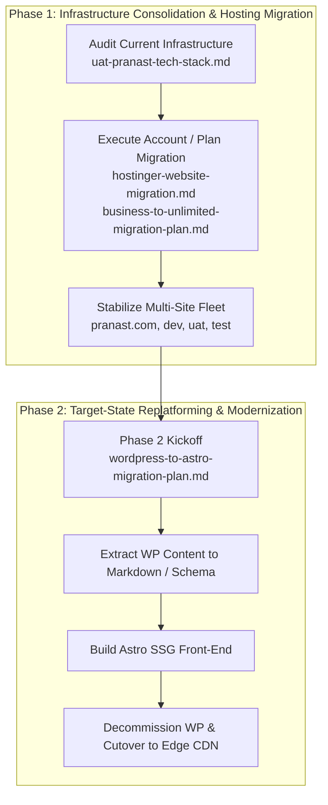

# Pranast Architecture & Infrastructure Documentation

Welcome to the central documentation portal for the **Pranast Digital Platform**. This directory maintains the architectural specifications, system audits, and operational runbooks governing both the current hosting environment and the future-state modernization roadmap.

---

## 🗺️ Documentation Matrix

| Domain | Document | Audience | Status | Description |
|---|---|---|---|---|
| **Architecture** | [As-Is Tech Stack Analysis](architecture/uat-pranast-tech-stack.md) | Architects, Tech Leads | Baseline Reference | Complete audit of WordPress 6.x, PHP 8.5, LiteSpeed, Elementor, and CDN infrastructure on `uat.pranast.com`. |
| **Architecture** | [WordPress to Astro Migration Blueprint](architecture/wordpress-to-astro-migration-plan.md) | Frontend Engineers, Architects | Approved Strategy | Technical blueprint for decommissioning WordPress/Elementor and replatforming to Astro Content Engine (SSG + Markdown). |
| **Architecture** | [Phase 1: Content Inventory & Schema](architecture/phase-1-content-inventory-schema.md) | Frontend Engineers, Content Team | Completed & Validated | Comprehensive inventory of all 17 pages, 6 blog posts, 40 media assets, forms, and Astro Zod collections from WP export. |
| **Architecture** | [Phase 2: Extraction & Scaffolding Report](architecture/phase-2-extraction-scaffolding-report.md) | Frontend Engineers, Architects | Completed & Validated | Pipeline parsing 100% XML content directly into typed Markdown collections, Astro 5 scaffolding, and 21 static routes compiled in 1.13s. |
| **Infrastructure** | [Cross-Account Hostinger Migration](infrastructure/hostinger-website-migration.md) | DevOps, SysAdmins | Operational Runbook | Step-by-step cutover procedures from source account (`u715171369`) to target account (`u797343708`) with zero data loss. |
| **Infrastructure** | [Business to Unlimited Plan Move](infrastructure/business-to-unlimited-migration-plan.md) | DevOps, Account Owners | Operational Runbook | Sequential migration order, backup strategies, and cutover steps for 5 websites across hosting tiers. |

---

## 🏗️ Strategic Architectural Roadmap

The documentation maps directly to the two-phase strategic lifecycle of the platform:



---

## 📂 Directory Structure

```text
docs/
├── README.md                                  # Central architecture & ops hub (this file)
├── architecture/                              # System designs, technical audits, and future blueprints
│   ├── phase-1-content-inventory-schema.md    # Phase 1 WordPress catalog & Astro typed schema
│   ├── uat-pranast-tech-stack.md              # Current WordPress/PHP/Elementor stack audit
│   └── wordpress-to-astro-migration-plan.md   # Target Astro + Markdown replatforming blueprint
└── infrastructure/                            # Infrastructure runbooks, hosting tier & cutover procedures
    ├── business-to-unlimited-migration-plan.md# Internal Hostinger tier migration (Business -> Unlimited)
    └── hostinger-website-migration.md         # Cross-account cutover plan (u715171369 -> u797343708)
```

---

## 📌 Document Summaries & Key Directives

### 1. Architecture

#### [Current State Tech Stack: uat.pranast.com](architecture/uat-pranast-tech-stack.md)
* **Focus:** Deep-dive analysis of the runtime, CMS plugins, server components, and asset delivery layers.
* **Key Findings:** Identifies dependencies on LiteSpeed Cache, Elementor AI, Prespa theme, and Ninja Forms, establishing baseline performance and security parameters.

#### [Modernization Blueprint: WordPress to Astro + Markdown](architecture/wordpress-to-astro-migration-plan.md)
* **Focus:** Enterprise modernization strategy eliminating dynamic PHP/MySQL attack surfaces in favor of pre-compiled Static Site Generation (SSG).
* **Core Outcomes:** Sub-100ms TTFB, 100/100 Lighthouse performance, typed content collections via Zod, and serverless form processing.

### 2. Infrastructure & Operations

#### [Cross-Account Hostinger Migration Runbook](infrastructure/hostinger-website-migration.md)
* **Focus:** Operational instructions for moving websites between Hostinger client accounts (`u715171369` → `u797343708`).
* **Critical Rule:** Domains can only attach to one site at a time. Sites must be staged on temporary subdomains before final DNS and SSL cutover.

#### [Business to Unlimited Hosting Plan Migration Plan](infrastructure/business-to-unlimited-migration-plan.md)
* **Focus:** Account consolidation and plan migration across 5 active domains (`pranast.com`, `dev`, `test`, `uat`, and Agentic mode site).
* **Sequence:** Strict migration order from lowest business criticality (`dev` → `uat` → `test` → `pranast.com`).

---

## 🛡️ Architecture Decision Records (ADRs) Summary

| Decision ID | Decision | Status | Rationale |
|---|---|---|---|
| **ADR-001** | Standardize docs under `/docs` hierarchy | **Adopted** | Separation of repository operational probes from technical architecture and runbooks. |
| **ADR-002** | Staged subdomain migration prior to DNS cutover | **Adopted** | Eliminates service downtime and avoids Hostinger single-domain binding conflicts. |
| **ADR-003** | Transition from WordPress/Elementor to Astro SSG | **Adopted** | Drastically reduces hosting footprint, eliminates continuous CVE patch churn, and maximizes Core Web Vitals. |
| **ADR-004** | Direct XML Content Extraction & Root Scaffolding | **Adopted** | Offline-verifiable pipeline parsing WXR XML directly with zero-JS Astro 5 root architecture. |

