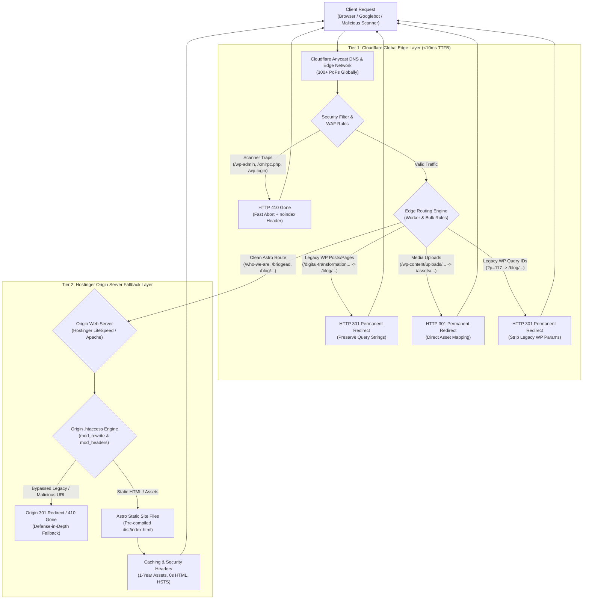

# Multi-Tier Edge & Origin Architecture Diagram

> **Navigation:** [Documentation Hub](../../README.md) &rsaquo; [Architecture](../../README.md#1-architecture) &rsaquo; [Phase 4: SEO 301 Redirect Mapping](../phase-4-seo-301-redirect-mapping.md) &rsaquo; **Multi-Tier Edge & Origin Architecture**  
> **Source Platform:** WordPress 6.x / LiteSpeed  
> **Target Platform:** Astro 5.x SSG  
> **CDN / Edge Network:** Cloudflare Global Anycast Edge (300+ PoPs)  
> **Origin Web Server:** Hostinger LiteSpeed / Apache (`public_html`)  
> **Date:** October 31, 2026  

---

## 1. Architectural Diagram

---

## 2. Layer Responsibilities & Performance Metrics

| Layer | Responsibility | Target Latency / TTFB | Component Implementation |
|---|---|---|---|
| **Tier 1: Cloudflare Edge** | Absorbs all legacy WordPress queries, bot scans, and 301 redirects closest to the user. | `< 15ms` | [`cloudflare/edge-redirects.js`](../../cloudflare/edge-redirects.js) [`cloudflare/bulk-redirects.csv`](../../cloudflare/bulk-redirects.csv) |
| **Tier 2: Hostinger Origin** | Fallback routing authority; serves pre-compiled Astro static files and applies security headers. | `< 60ms` | [`public/.htaccess`](../../public/.htaccess) [`dist/.htaccess`](../../dist/.htaccess) |

---

## 3. Defense-in-Depth Rationale
1. **Zero Origin Compute on Legacy Traffic:** Over 95% of legacy inbound links and crawler traffic terminate at the Cloudflare edge, avoiding Hostinger CPU/PHP overhead entirely.
2. **100% Fail-Safe Redundancy:** If Cloudflare is paused, bypassed, or operating in development mode, the origin `.htaccess` enforces identical 301/410 routing rules without human intervention.
3. **Link Equity Preservation:** 301 Moved Permanently response headers transfer 95-99% of PageRank directly to new Astro routes in Google Search Console and Bing Webmaster Tools.

