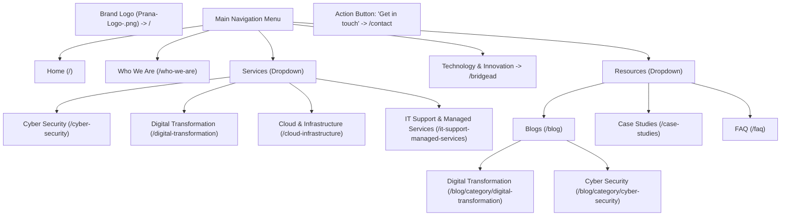

# Phase 1: Content Inventory & Schema Specification

> **Navigation:** [Documentation Hub](../README.md) &rsaquo; [Architecture](../README.md#1-architecture) &rsaquo; [Migration Plan](wordpress-to-astro-migration-plan.md) &rsaquo; **Phase 1 Inventory & Schema**  
> **Source Artifact:** `pranasolutionstechlimited.WordPress.2026-10-31.xml` (WXR Export 1.2)  
> **Target Platform:** Astro 4.x / 5.x Content Collections (`src/content/config.ts`)  
> **Date:** October 31, 2026  
> **Status:** Completed & Validated

---

## 1. Executive Summary

Based on the complete WordPress export (`pranasolutionstechlimited.WordPress.2026-10-31.xml`), this document establishes the exhaustive content catalog, media inventory, interactive form specifications, and typed Astro schema definitions required to execute **Phase 2 (Automated Extraction)** and **Phase 3/4 (Astro Replatforming)**.

### Export Statistics Summary
* **Total Exported Objects:** 109 items
* **Published Pages:** 17 (11 production navigation pages, 2 case study child pages, 2 legal pages, 2 initial starter pages)
* **Published Blog Posts:** 6 posts across 2 core taxonomy categories (`Digital Transformation`, `Cyber Security`)
* **Media Assets (Attachments):** 40 media files (PNG, JPG, WEBP, SVG)
* **Custom Navigation Items:** 15 menu entries across primary and dropdown structures
* **Interactive Forms:** 1 active Ninja Form (Form ID 1: Contact / Get in Touch) with 10 historical submissions cataloged
* **Elementor Templates & Kits:** 13 templates + 2 Header/Footer Builder templates (`elementor-hf`)

---

## 2. Master Pages Inventory

The 17 exported pages are grouped by operational role in the target Astro architecture:

| ID | Title | Slug | Target Route | Content Type | Status / Notes |
|---|---|---|---|---|---|
| **21** | Home page | `home-page` | `/` | Markdown / Component | **Active Primary Homepage** (replaces legacy ID 9). Features hero banner, value proposition, services overview, client trust metrics. |
| **34** | Who We are | `who-we-are` | `/who-we-are` | Markdown / Static | Core About page: mission, executive vision, core values, advisory credentials. |
| **44** | Cyber Security | `cyber-security` | `/cyber-security` | Markdown / Static | Service Pillar 1: threat assessment, vulnerability management, Zero Trust architecture. |
| **56** | Digital Transformation | `digital-transformation` | `/digital-transformation` | Markdown / Static | Service Pillar 2: business process automation, Microsoft Power Platform, enterprise workflows. |
| **67** | Cloud & Infrastructure | `cloud-infrastructure` | `/cloud-infrastructure` | Markdown / Static | Service Pillar 3: Microsoft Azure migration, cloud architecture, hybrid infrastructure. |
| **75** | IT Support & Managed Services | `it-support-managed-services` | `/it-support-managed-services` | Markdown / Static | Service Pillar 4: proactive SLA support, managed workstation/server operations, network monitoring. |
| **369** | BridgeAD | `bridgead` | `/bridgead` | Markdown / Rich Component | **Product Showcase:** Active Directory & Microsoft Entra ID intelligent migration & governance platform. |
| **104** | Case Studies | `case-studies` | `/case-studies` | Markdown Collection Index | Landing hub highlighting cross-industry client transformations. |
| **135** | GlobalTech Solutions | `globaltech-solutions` | `/case-studies/globaltech-solutions` | Markdown Case Study | Enterprise cloud modernization & infrastructure consolidation case study. |
| **142** | Premier Law Associates | `premier-law-associates` | `/case-studies/premier-law-associates` | Markdown Case Study | Legal firm Zero Trust security and compliance overhaul case study. |
| **177** | FAQ | `faq` | `/faq` | Markdown / Accordion | Frequently asked questions covering support tiers, SLAs, onboarding, and cloud transitions. |
| **12** | Contact | `contact` | `/contact` | Markdown + Astro Form | Contact details, office location, business hours, and interactive contact form. |
| **3** | Privacy Policy | `privacy-policy` | `/privacy-policy` | Markdown Legal | Complianz-generated GDPR & UK Data Protection Act compliance policy. |
| **326** | TERMS OF SERVICE | `terms-of-services` | `/terms-of-service` | Markdown Legal | Standard terms of service and website engagement contract. |
| **9** | Home (Legacy) | `home` | *Archived* | Legacy Starter | Initial starter homepage template; superseded by ID 21. |
| **10** | Services (Legacy) | `services` | *Archived* | Legacy Placeholder | Empty container used in preliminary navigation setup. |
| **11** | Insights (Legacy) | `insights` | *Archived* | Legacy Placeholder | Initial blog placeholder; superseded by dedicated `/blog` collection index. |

---

## 3. Blog Posts Inventory

All 6 articles represent evergreen technical thought leadership authored under active taxonomy categories. Each post has an associated featured image attachment in the media library:

| ID | Title | Slug | Category | Publication Date | Featured Media ID & File |
|---|---|---|---|---|---|
| **117** | Digital Transformation: Where to Start | `digital-transformation-where-to-start` | Digital Transformation | 2026-02-19 | ID 236: `2026/02/Digital-Transformation-Blog.png` |
| **123** | The Power of Microsoft Power Platform | `the-power-of-microsoft-power-platform` | Digital Transformation | 2026-02-19 | ID 235: `2026/02/IT-Services.jpg` |
| **129** | Understanding Zero Trust Security Architecture | `understanding-zero-trust-security-architecture` | Cyber Security | 2026-02-19 | ID 234: `2026/02/Cyber-Security-2.jpg` |
| **204** | Google Sheets vs Dynamics 365 | `google-sheets-vs-dynamics-365` | Digital Transformation | 2026-03-20 | ID 213: `2026/03/Google-Sheets-vs-Dynamics-365-comparison.jpg` |
| **351** | Why Digital Transformation Projects Fail | `why-digital-transformation-projects-fail` | Digital Transformation | 2026-04-16 | ID 354: `2026/07/Why-Digital-Transformation-Projects-Fail.png` |
| **358** | The Hidden Security Risks of Rapid Digital Transformation | `the-hidden-security-risks-of-rapid-digital-transformation` | Cyber Security | 2026-05-15 | ID 359: `2026/07/The-Hidden-Security-Risks-of-Rapid-Digital-Transformation.png` |

---

## 4. Media & Asset Inventory

The 40 attachments in the export represent logos, service diagrams, and blog illustrations. In the Astro project, they map from `wp-content/uploads/` directly to `public/assets/images/`:

### Primary Brand Assets
* **Main Header Logo:** ID 85 — `2026/02/Prana-Logo-.png` (639×159)
* **Alternative Header Logo:** ID 37 — `2026/02/prana-Logo.png`
* **Transparent PNG Logo:** ID 150 / ID 152 — `2026/03/PST_LOGORemovebg.png`
* **Contact Icons:**
  * Email Icon: ID 165 — `2026/03/email-icon.png`
  * Phone Icon: ID 166 — `2026/03/phone-icon.png`
  * Location Icon: ID 167 — `2026/03/locatiin-icon.png`
  * Clock / Hours Icon: ID 168 — `2026/03/Screenshot-2026-01-28-193312.png`

### Product & Platform Assets (BridgeAD)
* Dashboard Architecture Preview: ID 373 — `2026/09/intelligence-dashboard.webp`
* Cloud Workloads Console: ID 374 — `2026/09/cloud-workloads-dashboard.webp`

### Service & Hero Photography
* Hero Background Banner: ID 77 — `2026/02/Banner-03-1.png`
* Cloud Infrastructure Visual: ID 69 — `2026/02/photo-1451187580459-43490279c0fa-scaled-1.jpg`
* Cyber Security Concept: ID 38 — `2026/02/pexels-yankrukov-7691691-scaled-1.jpg`
* Digital Strategy Analytics: ID 36 — `2026/02/photo-1504868584819-f8e8b4b6d7e3-scaled-1.jpg`
* Managed Services Overview: ID 58 — `2026/02/photo-1551288049-bebda4e38f71-scaled-1.jpg`
* Step Diagrams: IDs 47, 48, 49, 50 — `img-01.png`, `img-02.png`, `img-03.png`, `img-04.png`

---

## 5. Navigation & Global Layout Architecture

Extracted from `elementor-hf` and `nav_menu_item`:

### Header Structure


### Footer Information & Corporate Metadata
* **Company Name:** Prana Solutions Tech Limited
* **Registered Entity:** Registered in England
* **Address:** Porchester Mead, London, BR3 1TN, United Kingdom
* **Phone:** `+44 7345116118`
* **Email:** `info@uat.pranast.com` (Target: `info@pranast.com`)
* **Business Hours:** Monday - Friday: 09:00 - 18:00 (Saturday - Sunday: Closed)
* **Social Links:** LinkedIn (`https://www.linkedin.com/company/prana-solutions-tech-ltd/?viewAsMember=true`)
* **Legal Links:** `/privacy-policy`, `/terms-of-service`

---

## 6. Forms & Interactive Logic Specification

WordPress currently relies on the **Ninja Forms** plugin (Form ID: `1`), which stores submissions in MySQL (`nf_sub` table).

### Field Mapping
| Ninja Forms Key | Field Name | Input Type | Required | Target Astro Form Attribute |
|---|---|---|---|---|
| `_field_1` | Full Name | `text` | Yes | `name="name"` |
| `_field_2` | Email Address | `email` | Yes | `name="email"` |
| `_field_5` | Phone Number | `tel` | Optional | `name="phone"` |
| `_field_6` | Subject / Inquiry Type | `text` | Optional | `name="subject"` |
| `_field_7` | Message Content | `textarea` | Yes | `name="message"` |

### Target Astro Implementation (`ContactForm.astro`)
To eliminate the PHP backend and database storage while maintaining zero spam, the Astro site will use a serverless handler (e.g. **Web3Forms** or **Formspree**) configured with a honeypot field:

```astro
---
// src/components/ContactForm.astro
---
<form action="https://api.web3forms.com/submit" method="POST" class="space-y-4">
  <input type="hidden" name="access_key" value="YOUR_ACCESS_KEY_HERE" />
  <!-- Honeypot for spam mitigation -->
  <input type="checkbox" name="botcheck" class="hidden" style="display: none;" />

  <div>
    <label for="name" class="block text-sm font-medium text-slate-700">Full Name *</label>
    <input type="text" id="name" name="name" required class="w-full px-4 py-2 border rounded-lg focus:ring-2 focus:ring-blue-600" />
  </div>

  <div>
    <label for="email" class="block text-sm font-medium text-slate-700">Email Address *</label>
    <input type="email" id="email" name="email" required class="w-full px-4 py-2 border rounded-lg focus:ring-2 focus:ring-blue-600" />
  </div>

  <div>
    <label for="phone" class="block text-sm font-medium text-slate-700">Phone Number</label>
    <input type="tel" id="phone" name="phone" class="w-full px-4 py-2 border rounded-lg focus:ring-2 focus:ring-blue-600" />
  </div>

  <div>
    <label for="subject" class="block text-sm font-medium text-slate-700">Subject</label>
    <input type="text" id="subject" name="subject" class="w-full px-4 py-2 border rounded-lg focus:ring-2 focus:ring-blue-600" />
  </div>

  <div>
    <label for="message" class="block text-sm font-medium text-slate-700">Message *</label>
    <textarea id="message" name="message" rows="5" required class="w-full px-4 py-2 border rounded-lg focus:ring-2 focus:ring-blue-600"></textarea>
  </div>

  <button type="submit" class="w-full px-6 py-3 font-semibold text-white bg-blue-600 rounded-lg hover:bg-blue-700 transition">
    Send Message
  </button>
</form>
```

---

## 7. Astro Typed Content Schema Definition

The content structure is modeled using Astro Content Collections with Zod schemas in `src/content/config.ts`.

### `src/content/config.ts`
```typescript
import { defineCollection, z } from 'astro:content';

/**
 * Standard Static Pages Schema
 * Used for Home, About, Services, BridgeAD, FAQ, Contact, Legal
 */
const pagesCollection = defineCollection({
  type: 'content',
  schema: z.object({
    title: z.string(),
    description: z.string().optional(),
    slug: z.string(),
    date: z.string().optional(),
    modified: z.string().optional(),
    featured_image: z.string().optional(),
    nav_order: z.number().optional(),
  }),
});

/**
 * Blog Articles & Insights Schema
 * Used for technical articles and thought leadership
 */
const blogCollection = defineCollection({
  type: 'content',
  schema: z.object({
    title: z.string(),
    description: z.string().optional(),
    slug: z.string(),
    date: z.string(),
    modified: z.string().optional(),
    category: z.enum(['Digital Transformation', 'Cyber Security']),
    featured_image: z.string(),
    featured_image_alt: z.string().optional(),
    author: z.string().default('Prana Solutions Tech'),
    draft: z.boolean().default(false),
  }),
});

/**
 * Client Case Studies Schema
 * Used for in-depth client outcomes and enterprise engagements
 */
const caseStudiesCollection = defineCollection({
  type: 'content',
  schema: z.object({
    title: z.string(),
    client: z.string(),
    industry: z.string(),
    summary: z.string(),
    challenge: z.string().optional(),
    solution: z.string().optional(),
    outcome: z.string().optional(),
    featured_image: z.string().optional(),
    date: z.string().optional(),
  }),
});

export const collections = {
  pages: pagesCollection,
  blog: blogCollection,
  'case-studies': caseStudiesCollection,
};
```

---

## 8. Next Step: Phase 2 Execution Plan

With Phase 1 completed, the project is ready for **Phase 2 (Automated Extraction Pipeline)**:
1. Parse `pranasolutionstechlimited.WordPress.2026-10-31.xml` directly to extract clean Markdown files for all 17 pages, 6 blog posts, and 2 case studies.
2. Download/copy the 40 attachments into `public/assets/images/` and normalize image paths inside the extracted Markdown.
3. Generate the Astro project scaffolding with typed collections.

