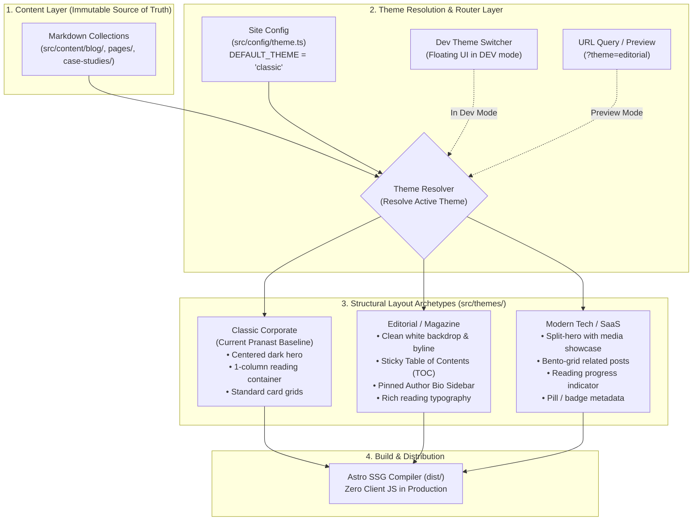
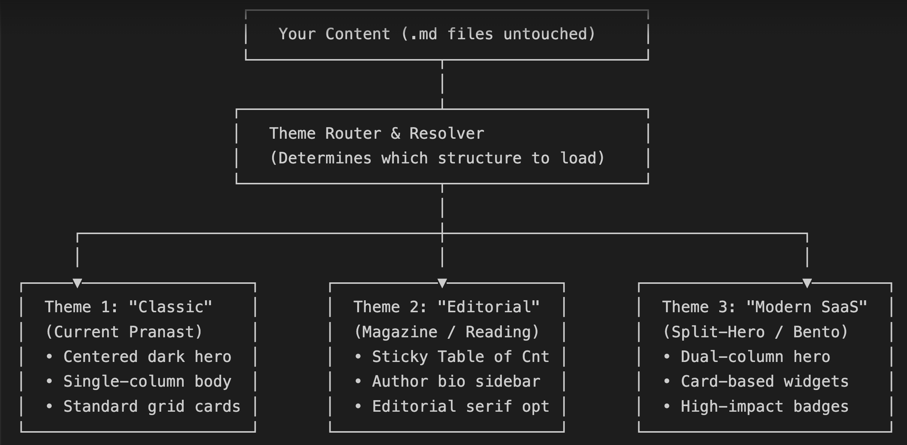

# Architecture Specification: Multi-Theme System & Structural Redesign Framework

## 1. Executive Summary & Context

The Pranast digital platform currently leverages an **Astro 7 (SSG)** architecture powered by **Tailwind CSS v4** and typed **Astro Content Collections** (`src/content/`). All core business content, case studies, and blog posts reside as clean, frontmatter-backed Markdown (`.md`) files.

This specification defines the architectural design for a decoupled **Multi-Theme Structural Redesign Engine**. This engine enables design experimentation, structural layout evaluation, and seamless production activation without modifying content files (`.md`) or disrupting existing production deployments.

---

## 2. Core Architectural Principles

1. **Strict Content-Presentation Decoupling**: Content files (`src/content/**/*.md`) remain 100% presentation-agnostic. No theme-specific markup or non-standard HTML leaks into Markdown.
2. **Unified Strategy (A + B + C)**:
   - **Strategy A (Production Single-Flag Activation)**: A centralized configuration flag governs the production build output.
   - **Strategy B (Dev-Only Interactive Switcher)**: An interactive floating pill UI injected strictly in local development (`import.meta.env.DEV`) allowing instant real-time theme swapping.
   - **Strategy C (Side-by-Side URL Parameter / Route Previews)**: Deterministic URL query parameter overrides (`?theme=<name>`) enable side-by-side browser comparisons.
3. **Zero Production Runtime Overhead**: Themes resolve during static compilation (`astro build`) or through lightweight client-side CSS class/state toggles in dev mode. Zero JavaScript overhead is introduced to production SSG output by default.
4. **Defensive Fallback**: If an invalid theme is requested, the system automatically falls back to `classic` without crashing the build or throwing a 500 runtime error.

---

## 3. High-Level System Architecture



---

## 4. Theme Archetypes Specification

### Theme 1: `classic` (Current Baseline)
* **Visual Tone**: Professional enterprise, corporate blue palette, high contrast.
* **Hero Structure**: Full-width dark gradient background (`from-slate-900 to-blue-950`) with white typography.
* **Content Layout**: Central single-column text container (`max-w-4xl`), bottom related posts grid (3 columns).
* **Navigation & Chrome**: Fixed white header with drop shadow, standard enterprise footer.

### Theme 2: `editorial` (Magazine / Long-Form Reading)
* **Visual Tone**: Clean, publication-grade, serif-enhanced headings, warm neutral off-white reading surfaces.
* **Hero Structure**: Minimalist, headline-first layout. Large typography with author avatar, reading time indicator, and category badges immediately visible above the fold.
* **Content Layout**: 
  - **Desktop (2-column)**: Sticky left or right sidebar containing an interactive Table of Contents (TOC) and author bio card; center-right content column (`prose-lg`) optimized for readability.
  - **Mobile**: Collapsible TOC drawer at the top of the article.
* **Navigation & Chrome**: Minimalist header border, discreet breadcrumbs.

### Theme 3: `modern-saas` (Bento & Split-Hero)
* **Visual Tone**: High-tech, dynamic, glassmorphic elements, modern sans-serif.
* **Hero Structure**: 50/50 split hero on desktop: left side displays title, abstract, and tags; right side showcases the featured image with rounded corners and subtle border glowing.
* **Content Layout**:
  - Full-width reading progress bar pinned to the top of the viewport.
  - Dynamic Bento-grid for "Next Steps", "Related Insights", and CTA blocks at the bottom of the article.
* **Navigation & Chrome**: Floating translucent navbar with blur backdrop filter (`backdrop-blur-md`).

---

## 5. Technical Blueprint & File Map

```
src/
├── config/
│   └── theme.ts                  # Theme types, registry, and active default selector
├── components/
│   ├── dev/
│   │   └── ThemeSwitcher.astro   # Floating UI switcher (active only when import.meta.env.DEV)
│   └── themes/                   # Theme-specific modular subcomponents
│       ├── TableOfContents.astro # Sticky TOC component for Editorial theme
│       ├── ReadingProgress.astro # Reading progress bar for Modern SaaS theme
│       └── AuthorBioCard.astro   # Author sidebar widget
├── layouts/
│   ├── BaseLayout.astro          # Root HTML head/meta shell
│   └── ThemeDispatcher.astro     # Dynamic dispatcher routing to the active theme layout
├── themes/
│   ├── ClassicTheme.astro        # Structural layout for Theme 1
│   ├── EditorialTheme.astro      # Structural layout for Theme 2
│   └── ModernTheme.astro         # Structural layout for Theme 3
└── pages/
    ├── blog/
    │   └── [slug].astro          # Consumes ThemeDispatcher passing Markdown Content
    └── [...slug].astro           # Dynamic pages consuming ThemeDispatcher
```

---

## 6. Implementation Stages & Roadmap

### Stage 1: Core Foundation & Configuration
* Create `src/config/theme.ts` defining:
  ```ts
  export type ThemeId = 'classic' | 'editorial' | 'modern-saas';
  export const ACTIVE_THEME: ThemeId = 'classic';
  ```
* Implement the theme dispatcher utility to safely load layouts based on config or query parameters.

### Stage 2: Editorial Theme Scaffolding
* Build `src/themes/EditorialTheme.astro`:
  * Extract headings from Markdown content to build a responsive, sticky Table of Contents.
  * Implement side-by-side reading layout with pinned author metadata.
  * Polish typography using Tailwind's `@tailwindcss/typography` (`prose`).

### Stage 3: Modern SaaS Theme Scaffolding
* Build `src/themes/ModernTheme.astro`:
  * Split-hero desktop layout.
  * Sticky reading progress bar.
  * Bento-style related post cards.

### Stage 4: Dev Theme Switcher (Strategy B) & Preview Routes (Strategy C)
* Build `src/components/dev/ThemeSwitcher.astro`.
* Conditionally render in `BaseLayout.astro` when `import.meta.env.DEV === true`.
* Store preference in `sessionStorage` or reload with `?theme=<id>` to preview any post across all 3 themes in seconds.

### Stage 5: Production Build Verification & Audit
* Run `npm run check` (TypeScript + Astro Schema).
* Run `npm run build` and ensure generated `dist/` is 100% clean, error-free, and adheres to static output guidelines.

---

## 7. Operational Guidelines for Maintenance
* **No Content Mutation**: Never insert theme-specific CSS classes directly into Markdown body copy.
* **Component Encapsulation**: Keep theme-specific components inside `src/themes/` or `src/components/themes/` to avoid polluting the core component catalog.
* **Clean Decommissioning**: When a single theme is permanently selected for production, unused themes can either be retained for future testing or archived cleanly without breaking any routes.

## The Combined Architecture: How It Works

