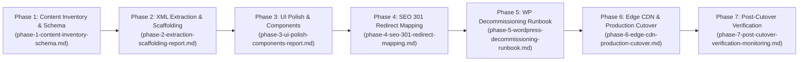

# Architecture Plan: Decommissioning WordPress & Migrating to Astro + Markdown

> **Navigation:** [Documentation Hub](../README.md) &rsaquo; [Architecture](../README.md#1-architecture) &rsaquo; **Target-State Modernization Blueprint**  
> **Related Document:** [As-Is Tech Stack Analysis](uat-pranast-tech-stack.md)

**Author:** Solutions Architecture Team (20+ Years Enterprise Web & CMS Engineering)  
**Target Domain:** `uat.pranast.com` / `pranast.com`  
**Current Architecture:** WordPress 6.x (PHP 8.5 + MySQL/MariaDB + Elementor + LiteSpeed Cache)  
**Target Architecture:** Astro Content Engine (Static Site Generation / Markdown / MDX / Zero-JS by default)  
**Status:** Approved Architectural Blueprint  

---

## 1. Executive Summary & Architectural Rationale

### Current Pain Points (WordPress + Elementor Stack)
1. **Maintenance & Security Surface:** Continuous CVE vulnerabilities in WordPress plugins (Elementor, form handlers, cache plugins), requiring constant PHP/WP patching.
2. **Runtime Overhead:** Dynamic database queries on every uncached page view, requiring MySQL connection pooling and aggressive LiteSpeed caching layers.
3. **Vendor & Tooling Bloat:** Elementor generates deeply nested DOM trees (`<div>` soup), inline styles, and render-blocking scripts, hurting Core Web Vitals (LCP, CLS, INP).
4. **Hosting Costs:** Requires PHP execution and database hosting resources.

### Target Architecture (Astro + Markdown)
1. **Zero Database / Zero PHP Runtime:** 100% static HTML, CSS, and minimal JS pre-rendered at build time.
2. **Git-Centric Content Management:** Content lives in version-controlled `.md` / `.mdx` files with typed YAML frontmatter.
3. **Sub-100ms TTFB & 100/100 Lighthouse:** No server processing latency; static assets served directly from edge CDNs.
4. **Resilience & Security:** Static files cannot be SQL-injected or compromised via PHP exploits.

---

## 2. Current State vs. Target State Comparison

| Feature / Metric | Current WordPress Stack | Target Astro Architecture |
|---|---|---|
| **Runtime** | PHP 8.5 + LiteSpeed Web Server | Pure Pre-compiled Static HTML/CSS |
| **Data Store** | MySQL / MariaDB (`wp_posts`, `wp_postmeta`) | Markdown (`.md`) files in Git repo |
| **Content Schema** | WordPress Dynamic Posts & Elementor JSON | Astro Typed Content Collections (`zod`) |
| **Page Layouts** | Elementor Drag-and-Drop Builder | Reusable Astro Components (`.astro`) |
| **Forms** | Ninja Forms (PHP Backend) | Serverless Form Service (Formspree, Web3Forms, or Cloudflare Worker) |
| **Hosting Requirement** | Dynamic PHP/MySQL Hostinger Plan | Hostinger Static, Cloudflare Pages, Vercel, or AWS S3 |
| **Monthly Maintenance** | Plugin updates, DB optimization, WP core patches | Zero runtime maintenance |

---

## 3. Migration Roadmap & Execution Phases



---

### Phase 1: Content Inventory & Schema Definition (Completed)
> **Detailed Specification:** See [Phase 1 Content Inventory & Schema](phase-1-content-inventory-schema.md) for the exact catalog of all 17 pages, 6 articles, 40 media attachments, and typed Zod schema.

Cataloged from `pranasolutionstechlimited.WordPress.2026-10-31.xml`:

1. **Pages Inventory:**
   - Home Page (`/` - ID 21)
   - About Us / Who We Are (`/who-we-are` - ID 34)
   - Services (`/cyber-security`, `/digital-transformation`, `/cloud-infrastructure`, `/it-support-managed-services`)
   - Technology & Innovation (`/bridgead` - ID 369)
   - Case Studies (`/case-studies`, `/case-studies/globaltech-solutions`, `/case-studies/premier-law-associates`)
   - FAQ (`/faq` - ID 177)
   - Contact Us (`/contact` - ID 12)
   - Legal: Privacy Policy (`/privacy-policy` - ID 3), Terms of Service (`/terms-of-service` - ID 326)
2. **Media Inventory:**
   - 40 Attachments cataloged with paths in `wp-content/uploads/` mapped to `public/assets/images/`.
3. **Forms & Interactive Logic:**
   - Ninja Form ID 1 (Name, Email, Phone, Subject, Message) documented for replacement with `ContactForm.astro` via Web3Forms/Formspree.
4. **SEO & Metadata:**
   - Meta title, meta description, and featured images mapped to Astro Frontmatter.

---

### Phase 2: Automated Content Extraction Pipeline

Extract content directly via the WordPress REST API (`/wp-json/wp/v2/`) before decommissioning. This preserves page titles, slugs, publication dates, and hierarchy without requiring direct SQL access.

#### Automated Extraction Script (`extract-wp.js`)
Run this Node.js script locally to fetch all pages, convert HTML to clean Markdown, download associated images, and structure YAML frontmatter:

```javascript
/**
 * extract-wp.js
 * Automated Content Extractor: WordPress REST API -> Astro Markdown
 */
const fs = require('fs');
const path = require('path');
const https = require('https');
const TurndownService = require('turndown');

const WP_API_URL = 'https://uat.pranast.com/wp-json/wp/v2/pages?per_page=100';
const OUTPUT_DIR = path.join(__dirname, 'src', 'content', 'pages');
const ASSETS_DIR = path.join(__dirname, 'public', 'assets', 'images');

// Initialize HTML-to-Markdown converter
const turndown = new TurndownService({
  headingStyle: 'atx',
  codeBlockStyle: 'fenced'
});

// Remove Elementor-specific clutter
turndown.addRule('stripElementorWrappers', {
  filter: ['span', 'div'],
  replacement: (content) => content
});

async function fetchJSON(url) {
  return new Promise((resolve, reject) => {
    https.get(url, { headers: { 'User-Agent': 'Mozilla/5.0' } }, (res) => {
      let data = '';
      res.on('data', (chunk) => data += chunk);
      res.on('end', () => resolve(JSON.parse(data)));
    }).on('error', reject);
  });
}

async function run() {
  fs.mkdirSync(OUTPUT_DIR, { recursive: true });
  fs.mkdirSync(ASSETS_DIR, { recursive: true });

  console.log('Fetching pages from WordPress REST API...');
  const pages = await fetchJSON(WP_API_URL);

  for (const page of pages) {
    const slug = page.slug;
    const title = page.title.rendered;
    const rawHtml = page.content.rendered;
    const markdownContent = turndown.turndown(rawHtml);

    // Frontmatter structure for Astro
    const frontmatter = `---
title: "${title.replace(/"/g, '\\"')}"
slug: "${slug}"
date: "${page.date}"
modified: "${page.modified}"
description: "Content from ${title}"
---

`;

    const filePath = path.join(OUTPUT_DIR, `${slug}.md`);
    fs.writeFileSync(filePath, frontmatter + markdownContent, 'utf-8');
    console.log(`Extracted: ${slug}.md`);
  }

  console.log('\nExtraction complete. All pages saved to src/content/pages/');
}

run().catch(console.error);
```

---

### Phase 3: Content Cleansing & Componentization

WordPress and Elementor inject inline wrapper markup. During conversion:
1. **Clean Markdown:** Ensure headers (`#`, `##`), bullet points, blockquotes, and links are formatted as standard GitHub Flavored Markdown.
2. **Extract Reusable Layout Elements:**
   - Navigation header and footer become Astro components: `src/components/Header.astro`, `src/components/Footer.astro`.
   - Contact form becomes `src/components/ContactForm.astro` connected to a serverless endpoint (e.g., Formspree or Web3Forms).

---

### Phase 4: Astro Project Architecture

#### Directory Structure
```
my-astro-site/
├── public/
│   ├── favicon.svg
│   └── assets/images/          # Extracted media assets
├── src/
│   ├── components/
│   │   ├── Header.astro         # Top navigation & branding
│   │   ├── Footer.astro         # Footer, links, copyright
│   │   └── ContactForm.astro    # Clean HTML form (replaces Ninja Forms)
│   ├── content/
│   │   ├── config.ts            # Type-safe Zod schema validation
│   │   └── pages/               # All extracted .md files (Who We Are, Home, etc.)
│   │       ├── home.md
│   │       ├── who-we-are.md
│   │       ├── services.md
│   │       └── contact.md
│   ├── layouts/
│   │   └── BaseLayout.astro     # Root HTML, SEO meta tags, CSS
│   └── pages/
│       ├── index.astro          # Landing page
│       └── [...slug].astro      # Dynamic catch-all router for Markdown content
├── astro.config.mjs             # Astro build configuration
├── package.json
└── tsconfig.json
```

#### Typed Content Collection Schema (`src/content/config.ts`)
```typescript
import { defineCollection, z } from 'astro:content';

const pagesCollection = defineCollection({
  type: 'content',
  schema: z.object({
    title: z.string(),
    description: z.string().optional(),
    slug: z.string(),
    date: z.string().optional(),
    featured_image: z.string().optional(),
  }),
});

export const collections = {
  pages: pagesCollection,
};
```

#### Dynamic Markdown Page Renderer (`src/pages/[...slug].astro`)
```astro
---
import { getCollection } from 'astro:content';
import BaseLayout from '../layouts/BaseLayout.astro';

export async function getStaticPaths() {
  const pages = await getCollection('pages');
  return pages.map(entry => ({
    params: { slug: entry.slug === 'home' ? undefined : entry.slug },
    props: { entry },
  }));
}

const { entry } = Astro.props;
const { Content } = await entry.render();
---

<BaseLayout title={entry.data.title} description={entry.data.description}>
  <article class="max-w-4xl mx-auto px-4 py-12 prose prose-slate">
    <h1>{entry.data.title}</h1>
    <Content />
  </article>
</BaseLayout>
```

---

### Phase 5: Local Testing & Validation

1. **Install Dependencies & Run:**
   ```bash
   npm install astro @astrojs/tailwind
   npm run dev
   ```
   Open `http://localhost:4321` to verify all content, headings, and images.
2. **Build Verification:**
   ```bash
   npm run build
   ```
   Astro will compile all Markdown pages into pure static HTML files inside `dist/`.

---

### Phase 6: Disconnecting & Decommissioning WordPress

> [!IMPORTANT]
> Do not delete the WordPress installation or database until the Astro application has been fully compiled, reviewed, and approved.

#### Step 1: Create Full Archival Snapshots (Safety Fallback)
1. In Hostinger hPanel, go to **Websites → Manage → Backups**.
2. Download:
   - **Files Backup:** `uat_wordpress_files.tar.gz`
   - **Database Backup:** `uat_wordpress_database.sql`
3. Store these archives securely offline.

#### Step 2: Decommission WordPress Execution
1. In Hostinger File Manager for `uat.pranast.com`:
   - Delete or move the WordPress core folders (`/wp-admin`, `/wp-includes`, `/wp-content/plugins`).
   - Remove `wp-config.php` and `index.php`.
2. In Hostinger hPanel **Databases**:
   - Detach and delete the WordPress MySQL database and database user.
3. This eliminates:
   - PHP process consumption.
   - MySQL database connection limits and CPU load.
   - All WordPress security attack vectors.

---

### Phase 7: Deploying the Astro Site to Hostinger

1. Run the local production build:
   ```bash
   npm run build
   ```
2. Upload the contents of the `dist/` directory directly into the domain's document root on Hostinger:
   `/home/u715171369/domains/pranast.com/public_html/uat/`
3. Configure `.htaccess` for optimal caching, gzip/brotli compression, and clean URLs:
   ```apache
   # Enable clean URLs and browser caching for static Astro build
   Options -Indexes
   DirectoryIndex index.html

   <IfModule mod_rewrite.c>
     RewriteEngine On
     RewriteCond %{REQUEST_FILENAME} !-f
     RewriteCond %{REQUEST_FILENAME} !-d
     RewriteRule ^(.*)/$ /$1 [L,R=301]
   </IfModule>

   <IfModule mod_expires.c>
     ExpiresActive On
     ExpiresDefault "access plus 1 month"
     ExpiresByType text/html "access plus 0 seconds"
   </IfModule>
   ```
4. Verify HTTPS and SSL via Hostinger hPanel.

