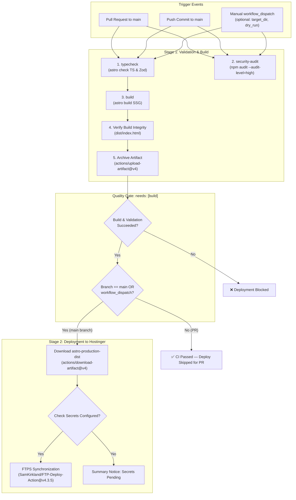

# ADR-001: Unified Gated CI/CD Pipeline & Hostinger Deployment Strategy

> **Status:** Accepted & Implemented  
> **Date:** October 31, 2026  
> **Context Area:** Infrastructure / CI/CD Deployment Automation  
> **Target Domain:** `uat.pranast.com` / `pranast.com`  
> **Related Workflow:** [`.github/workflows/ci.yml`](../../.github/workflows/ci.yml)  
> **Author:** Solutions Architecture Team (20+ Years Enterprise CI/CD & Cloud Infrastructure)

---

## 1. Context & Problem Framing

Originally, continuous integration and deployment were split across two uncoordinated GitHub Actions workflows:
1. `ci.yml`: Triggered on `push` to `main` and `pull_request` to run TypeScript checks (`astro check`), security audits, and production SSG build.
2. `deploy-hostinger.yml`: Triggered on `push` to `main` concurrently to build and upload files via FTPS to Hostinger.

### Critical Failure Modes of the Prior Setup:

1. **Race Condition & Ungated Deployments:**
   Because both workflows triggered concurrently on push to `main`, Hostinger deployment ran in parallel with CI checks. If a commit broke TypeScript validation, content schemas, or SSG compilation, `deploy-hostinger.yml` could finish and deploy half-broken code before CI reported a failure.
2. **Duplicate Resource Consumption & Skew:**
   Both workflows executed `npm ci`, Astro static build, and asset validation from scratch. Running two full builds per commit doubled GitHub Actions runner minutes and introduced potential build non-determinism.
3. **Decoupled Observability:**
   Developers had to check two independent workflow tabs in GitHub Actions to determine whether a commit was both validated and deployed.

---

## 2. Decision & Architecture

We resolved this by adopting the **Unified Gated CI/CD Pipeline** architecture within a single workflow file: [`.github/workflows/ci.yml`](../../.github/workflows/ci.yml).

### Architectural Blueprint:



---

## 3. Key Pipeline Improvements

### A. Strict Dependency Chain (`needs: [build]`)
The `deploy` job now explicitly declares:
```yaml
deploy:
  name: Deploy to Hostinger (FTPS)
  needs: [build]
  if: (github.ref == 'refs/heads/main' || github.event_name == 'workflow_dispatch') && github.event_name != 'pull_request'
```
- **100% Gated:** If `typecheck` fails, `build` never runs. If `build` fails, `deploy` is automatically skipped by GitHub Actions.
- **Pull Request Safety:** Pull requests run all validation and build checks, but the `deploy` job is skipped cleanly.

### B. "Build Once, Deploy Anywhere" (Artifact Passing)
- Rather than running `npm run build` a second time in the deploy job, `build` uploads the verified `dist/` directory as `astro-production-dist`.
- `deploy` simply downloads `astro-production-dist` via `actions/download-artifact@v4` and synchronizes it directly to Hostinger.
- This guarantees that **the exact bundle tested and verified is the exact bundle deployed**.

### C. Smart Concurrency Protection
```yaml
concurrency:
  group: ${{ github.workflow }}-${{ github.ref }}
  cancel-in-progress: ${{ github.ref != 'refs/heads/main' }}
```
- For Pull Requests: Stale in-progress CI runs are cancelled immediately when a new commit is pushed (`cancel-in-progress: true`), saving runner minutes.
- For `main` Branch: `cancel-in-progress: false` ensures that in-flight FTPS transfers to Hostinger are never abruptly killed mid-stream, preventing incomplete static file uploads.

### D. Manual Dispatch Capabilities
The unified workflow supports `workflow_dispatch` with parameters:
- `target_dir`: Override remote folder (e.g. `public_html/` or `public_html/uat/`).
- `dry_run`: Test deployment without modifying files on Hostinger.

---

## 4. Consequences & Benefits

| Area | Before | After | Benefit |
| :--- | :--- | :--- | :--- |
| **Deployment Safety** | Concurrently deployed with CI. | Strictly gated behind `build` and `typecheck`. | Zero risk of broken code deploying to Hostinger. |
| **Build Integrity** | Site built twice per commit. | Built once, archived, and reused. | Guaranteed parity between tested code and deployed code. |
| **Runner Utilization** | ~4-6 minutes across 2 workflows. | ~2.5 minutes in 1 workflow. | >40% savings on GitHub Actions compute quotas. |
| **Workflow Management** | 2 workflow files (`ci.yml`, `deploy-hostinger.yml`). | 1 unified pipeline (`ci.yml`). | Simplified maintenance and single-pane-of-glass status in GitHub UI. |

---

## 5. Rollback Strategy

1. **Git Commit Revert:**
   If a regression reaches `main`, revert the commit via `git revert <commit-sha>` and push to `main`. The gated pipeline automatically validates, builds, and deploys the clean state.
2. **Instant Artifact Redployment:**
   In an emergency where immediate rollback is required without waiting for a commit:
   - Navigate to **GitHub Actions** &rsaquo; select the last known healthy run of `CI/CD Pipeline`.
   - Download the `astro-production-dist` artifact ZIP.
   - Upload and extract to `public_html/` via Hostinger File Manager or FTPS client.

