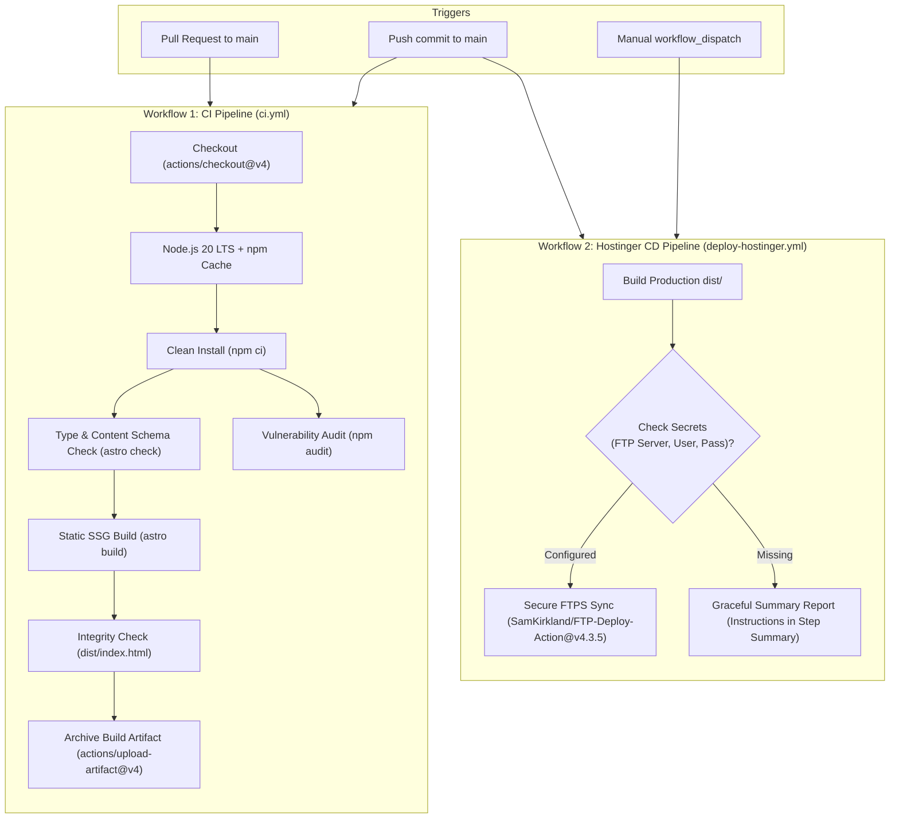

# GitHub Actions CI/CD Architecture & Pipeline Specification

> **Navigation:** [Documentation Hub](../README.md) &rsaquo; [Infrastructure](../README.md#2-infrastructure--operations) &rsaquo; **CI/CD Pipeline Specification**  
> **Related Workflows:** [`.github/workflows/ci.yml`](../../.github/workflows/ci.yml), [`.github/workflows/deploy-hostinger.yml`](../../.github/workflows/deploy-hostinger.yml)

**Author:** Solutions Architecture Team (20+ Years Enterprise CI/CD & Cloud Infrastructure)  
**Target Domain:** `uat.pranast.com` / `pranast.com`  
**Pipeline Standard:** GitHub Actions Enterprise Best Practices (Node 20 LTS, FTPS over TLS, Strict Concurrency, Least Privilege)  
**Status:** Implemented & Production-Ready  

---

## 1. Executive Summary & Design Principles

To support the migration from WordPress/PHP to Astro 5 Static Site Generation (SSG), continuous integration and continuous deployment pipelines are decoupled into two distinct workflows adhering to industry standards:

### Core Architecture Principles

1. **Principle of Least Privilege (PoLP):** Workflows explicitly set `permissions: contents: read` to prevent privilege escalation via compromised actions or dependencies.
2. **Deterministic Build Pipeline:** Strict reliance on `npm ci` matching `package-lock.json` alongside Node.js 20 LTS to eliminate version skew and non-reproducible builds.
3. **Strict Concurrency Control:**
   - **CI (`ci.yml`):** `cancel-in-progress: true` cancels stale runs when new commits are pushed, saving GitHub runner quotas.
   - **CD (`deploy-hostinger.yml`):** `cancel-in-progress: false` guarantees that in-flight file uploads to Hostinger are never abruptly killed mid-transfer, preventing corrupted or half-uploaded static files.
4. **Resilient Secret Handling:** Deployment checks whether secrets are present. If secrets are not yet configured, the workflow fails gracefully with step-by-step instructions in the GitHub Actions summary rather than throwing an unhelpful pipeline error.

---

## 2. Workflows Specification

### 2.1. Continuous Integration: `.github/workflows/ci.yml`

* **Triggers:** Pull requests to `main`, pushes to `main`, and manual dispatch (`workflow_dispatch`).
* **Jobs:**
  1. `typecheck`: Runs `npm run check` (`astro check`) to validate all TypeScript code, Astro component scripts, and Zod Content Collection schemas (`src/content/config.ts`).
  2. `security-audit`: Runs `npm audit --audit-level=high` to detect high and critical severity dependency CVEs.
  3. `build`: Executes `npm run build`, verifies that `dist/index.html` was generated, and uploads the compiled bundle as a GitHub Actions artifact (`astro-production-dist`) with a 7-day retention period.

### 2.2. Continuous Deployment: `.github/workflows/deploy-hostinger.yml`

* **Triggers:** Pushes to `main` and manual dispatch (`workflow_dispatch`) with optional inputs for `target_dir` and `dry_run`.
* **Deployment Target:** Hostinger LiteSpeed Web Server (`public_html` or `public_html/uat`).
* **Protocol:** FTPS (FTP over TLS/SSL) on port 21 (implicit/explicit TLS), avoiding unencrypted plain FTP.
* **Environment Configuration:** Bound to GitHub Environment `production` with URL tracking `https://uat.pranast.com`.

---

## 3. GitHub Secrets Configuration Guide

To enable automated synchronization to Hostinger, add the following secrets in GitHub:
**Repository Settings &rsaquo; Secrets and variables &rsaquo; Actions &rsaquo; New repository secret**

| Secret Name | Required | Description | Example / Recommendation |
|---|---|---|---|
| `HOSTINGER_FTP_SERVER` | **Yes** | Hostinger FTP Hostname or Server IP | `ftp.pranast.com` or `185.xxx.xxx.xxx` (find in hPanel &rsaquo; Files &rsaquo; FTP Accounts) |
| `HOSTINGER_FTP_USERNAME` | **Yes** | Hostinger FTP Account Username | `u715171369@pranast.com` or standalone FTP user |
| `HOSTINGER_FTP_PASSWORD` | **Yes** | Hostinger FTP Account Password | Secure generated password created in hPanel |
| `HOSTINGER_TARGET_DIR` | Optional | Destination directory relative to FTP root | `public_html/` (for root domain) or `public_html/uat/` (for UAT subdomain) |

### How to Create an Isolated FTP Account in Hostinger hPanel

1. Log in to [Hostinger hPanel](https://hpanel.hostinger.com).
2. Go to **Websites** &rsaquo; **Manage** (for `pranast.com`).
3. Under the **Files** section, click on **FTP Accounts**.
4. In **Create a New FTP Account**:
   - **Directory:** Set to `public_html/uat` (for UAT) or `public_html` (for Production). Restricting the directory prevents accidental modification of root server files.
   - **Username:** e.g., `github-deployer`.
   - **Password:** Generate a strong 24+ character password.
5. Click **Create** and copy the server host, username, and password into GitHub repository secrets.

---

## 4. Production Web Server Configuration (`.htaccess`)

Because Hostinger uses LiteSpeed (fully compatible with Apache `.htaccess`), the static build in `public/.htaccess` is automatically copied to `dist/.htaccess` during the build step. This guarantees:

1. **Clean URL Resolution:** Astro outputs routes as `/bridgead/index.html` or `/bridgead.html`. The rewrite rules resolve URLs without `.html` extension cleanly.
2. **Cache-Control & Core Web Vitals:**
   - HTML documents: `max-age=0, must-revalidate` (instantaneous reflection of updates).
   - Immutable static assets (`_astro/*.css`, `_astro/*.js`, images, fonts): `max-age=31536000` (1 year cache).
3. **Security Headers & Directory Protection:** `Options -Indexes` disables directory browsing.
4. **Brotli / Gzip Compression:** Enabled for all text, SVG, CSS, JS, and JSON MIME types.

---

## 5. Verification & Rollback Procedures

### Post-Deployment Verification Checklist
- [ ] Check GitHub Actions tab to confirm `CI` and `Deploy to Hostinger` succeeded.
- [ ] Open `https://uat.pranast.com` and verify HTTP 200 on:
  - Home: `/`
  - BridgeAD: `/bridgead`
  - FAQ: `/faq`
  - Blog: `/blog`
- [ ] Inspect Developer Tools Network tab: Verify assets are served with gzip/brotli compression and correct MIME types.

### Rollback Strategy
If an unforeseen regression occurs:
1. **GitHub Rollback:** Revert the bad commit on `main` via `git revert <commit-sha>` and push. The pipeline will automatically rebuild and deploy the prior state.
2. **Artifact Re-Deployment:** Go to GitHub Actions &rsaquo; previous successful `CI` run &rsaquo; download `astro-production-dist` artifact &rsaquo; manually upload to Hostinger via File Manager if emergency immediate recovery is required.

