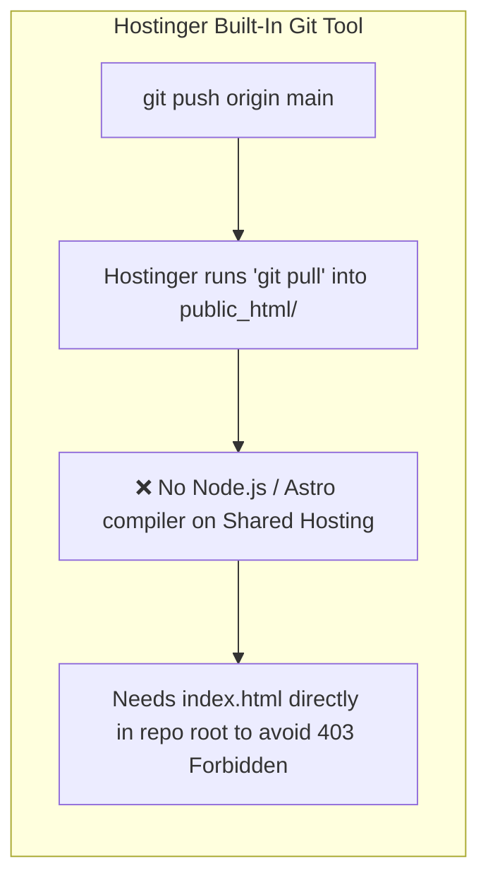
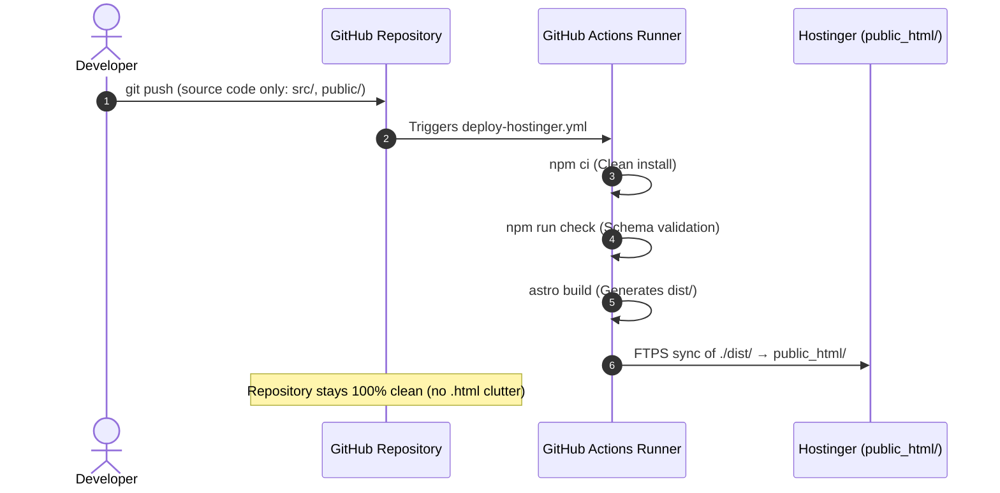
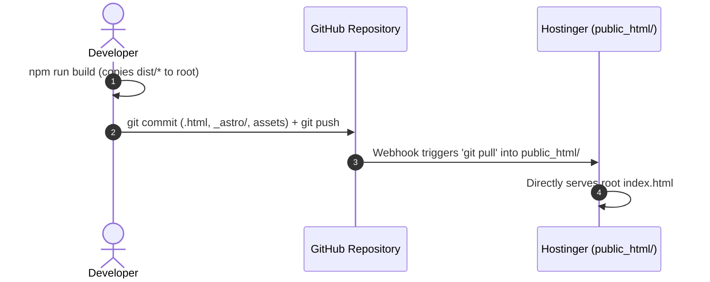

# HTML Build Artifacts & Deployment Strategy

> **Navigation:** [Documentation Hub](../README.md) &rsaquo; [Infrastructure](../README.md#2-infrastructure--operations) &rsaquo; **HTML Build Artifacts & Deployment Guide**  
> **Related Files:** [`package.json`](../../package.json), [`.github/workflows/deploy-hostinger.yml`](../../.github/workflows/deploy-hostinger.yml), [`.gitignore`](../../.gitignore)

---

## 1. Executive Summary & Problem Framing

### Why are so many `.html` files appearing in the repository?
When running `npm run build`, dozens of static files (`index.html`, `blog/index.html`, `contact/index.html`, `_astro/*.css`, etc.) get copied directly into the repository root.

The root cause is in [`package.json`](../../package.json#L8):
```json
"scripts": {
  "build": "astro build && cp -r dist/* . && cp dist/.htaccess ."
}
```

By default, Astro compiles all pages into isolated static output in the `dist/` directory. The secondary command (`&& cp -r dist/* .`) mirrors everything from `dist/` directly into the repository root directory.

---

## 2. Why Was This Done Originally?

In commit [`6e99c2d`](https://github.com/pranast/pranast-website/commit/6e99c2d) (*"fix(deployment): add compiled static assets and .htaccess for Hostinger auto-deploy"*), this mirror command was added to solve a specific Hostinger limitation:



Hostinger's built-in Git deployment hook (under **hPanel > Advanced > Git**) only performs a raw `git pull`. It **cannot execute build scripts** (`npm run build`) on shared hosting. 

Consequently, without pre-compiled HTML files in the repository root, Hostinger served a **403 Forbidden** error because `public_html/` only contained Astro source files (`src/`, `package.json`, etc.) without a compiled `index.html`.

---

## 3. Do You Need to Commit Them?

**Short Answer:**
- **NO**, if you use the **GitHub Actions CI/CD Pipeline** (already configured in this repository).
- **YES**, only if you bypass CI/CD and rely strictly on **Hostinger's hPanel Git pull tool**.

---

## 4. Architectural Comparison: Two Deployment Paths

### Option A: GitHub Actions CI/CD (Industry Standard — Recommended)

In this approach, compilation happens on GitHub's cloud runners, and only the final `dist/` folder is transferred to Hostinger via secure FTPS.



#### Advantages:
1. **Clean Version Control:** Git history only tracks human-authored code and markdown content. No noisy diffs containing minified HTML, generated timestamps, or hash-named CSS bundles (`_astro/*.css`).
2. **Deterministic Builds:** The site is always compiled in a clean, reproducible container (Node.js 20 LTS).
3. **Zero Hostinger CPU Overhead:** Hostinger only receives static files and serves them with maximum performance.

---

### Option B: Hostinger Direct Git Mirroring (Legacy Workaround)

In this approach, you compile the site on your local workstation and commit the compiled output to git so Hostinger can pull it.



#### Disadvantages:
1. **Repository Bloat:** The repository size grows rapidly as new image hashes and bundled assets get committed with every change.
2. **Merge Conflicts:** Simultaneous changes produce unresolvable merge conflicts in minified HTML and CSS files.
3. **Manual Overhead:** Forgetting to run `npm run build` locally before pushing will deploy outdated HTML to production.

---

## 5. Transition & Cleanup Plan (To Enable Option A)

If you want to keep the repository clean and let GitHub Actions handle all builds and deployments:

### Step 1: Configure Hostinger Deployment Secrets in GitHub
Ensure the following three secrets are set in your GitHub repository (**Settings > Secrets and variables > Actions**):

| Secret Name | Value Example | Description |
|---|---|---|
| `HOSTINGER_FTP_SERVER` | `ftp.pranast.com` or Hostinger Server IP | FTP host from hPanel |
| `HOSTINGER_FTP_USERNAME` | `u715171369@pranast.com` | FTP account username |
| `HOSTINGER_FTP_PASSWORD` | `••••••••••••` | FTP account password |
| `HOSTINGER_TARGET_DIR` | `public_html/` | Target directory on server |

### Step 2: Clean `package.json` Build Script
Update the `build` script in [`package.json`](../../package.json#L8) back to the standard Astro build command:

```diff
- "build": "astro build && cp -r dist/* . && cp dist/.htaccess .",
+ "build": "astro build",
```

### Step 3: Remove Generated HTML & Asset Artifacts from Git
Run the following commands locally to untrack and remove the generated artifacts without deleting your source code:

```bash
# Remove root static HTML pages
git rm -r --cached blog/*.html case-studies/*.html category/*.html *.html 2>/dev/null
git rm -r --cached bridgead/ cyber-security/ digital-transformation/ it-support-managed-services/ 2>/dev/null
git rm -r --cached privacy-policy/ terms-of-service/ who-we-are/ cloud-infrastructure/ contact/ faq/ 2>/dev/null

# Remove bundled assets and generated sitemaps
git rm -r --cached _astro/ sitemap-*.xml robots.txt .htaccess 2>/dev/null

# Remove local leftover build files from working directory
rm -rf _astro/ sitemap-0.xml sitemap-index.xml robots.txt .htaccess index.html

# Commit the clean state
git commit -m "chore(build): untrack root build artifacts and restore clean SSG pipeline"
git push origin main
```

---

## 6. Summary Decision Matrix

| Requirement | Option A: GitHub Actions (Recommended) | Option B: Git Root Mirror |
|---|---|---|
| **Do I need to commit `.html` files?** | **NO** (Never commit generated files) | **YES** (Must commit on every edit) |
| **Where does the build happen?** | GitHub Actions cloud runner | Local machine |
| **Server requirement** | Secure FTPS access credentials | Hostinger Git webhook |
| **Git repository health** | Clean, lightweight, readable PRs | High clutter, noisy merge conflicts |
| **Deployment file target** | Uploads `./dist/` to `public_html/` | Clones entire repo into `public_html/` |

